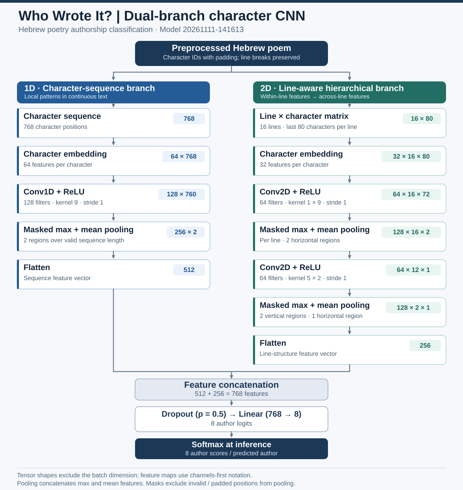

# Who Wrote It? — Hebrew Poetry Authorship Classification

*A character-level deep learning project using Python and PyTorch*

**[Try the interactive demo](https://who-wrote-it.streamlit.app/)**

[Installation, reproduction instructions, and repository structure](RUNNING.md)

## Overview

**Who Wrote It?** is a deep learning project that attempts to identify the author of a Hebrew poem based on its textual and structural characteristics.

The task is formulated as an eight-class authorship classification problem, covering poets from different historical periods and literary traditions, including medieval Hebrew poetry and modern Israeli poetry.

The project explores whether relatively small convolutional neural networks (CNNs), trained from scratch on a limited dataset, can learn distinctive stylistic features without relying on pretrained language models.

Particular attention is given to the structure of poetry: line boundaries, character patterns within lines, and possible relationships between adjacent lines.

The project covers the full machine learning workflow, from data preparation to model development, experimental evaluation, error analysis, and an interactive inference application.

## 1. Motivation and Dataset Selection

The project began as an experiment in identifying the authors of social media posts by Israeli politicians.

However, this approach presented two significant challenges:

- The available labeled dataset was relatively small.
- A politician's public writing style may change over time, potentially because different staff members contribute to the published content.

Hebrew poetry offered an alternative with more examples per author and an interesting relationship between textual style and formal structure.

The selected source was **Project Ben-Yehuda**, a freely accessible digital collection of Hebrew literature.

Eight poets were selected: Haim Nahman Bialik, Shaul Tchernichovsky, Rachel Bluwstein, Avraham Shlonsky, Dan Almagor, Yehuda Halevi, Solomon ibn Gabirol, and Rachel Shapira.

After preprocessing and filtering, the dataset contained 2,943 poems.

## 2. Data Preparation

Data quality was a major challenge. The original collection contains literary works alongside metadata, editorial text, notes, and multiple versions of some works.

A preprocessing pipeline was developed using **Python, pandas, NumPy, regular expressions, and RapidFuzz**.

### Filtering and validation

The pipeline included:

1. **Metadata filtering:** selecting the relevant authors and works marked as originally written in Hebrew.
2. **Length filtering:** excluding very short texts.
3. **Poetry-specific heuristics:** examining the density of Hebrew vowel marks (*niqqud*) and average line lengths to help distinguish poetry from other textual material.
4. **Editorial content removal:** removing standard headers, author credits, source footers, and leading or trailing editorial notes.
5. **Text normalization:** removing vowel marks and numeric characters while retaining line structure.
6. **Duplicate detection:** identifying exact and near-duplicate versions of poems using normalized-text similarity.

Duplicate removal was performed before splitting the dataset, reducing the risk that different versions of the same poem would appear in both training and evaluation sets.

### Dataset splitting

The cleaned dataset was divided using stratified sampling:

| Dataset    | Proportion | Number of poems |
|------------|-----------:|----------------:|
| Training   |        70% |           2,060 |
| Validation |        15% |             441 |
| Test       |        15% |             442 |
| Total      |       100% |           2,943 |

Stratification preserved approximately the same author distribution across the subsets.

The validation set was used for architecture selection and experimentation. The held-out test set was used for the final evaluation.

## 3. Modeling Approach

The relatively small training set influenced the architectural choices.

Instead of training a model that requires a large vocabulary or extensive semantic representation, the project uses **character-level embeddings and convolutional neural networks**.

Character-level processing offers several potential advantages for this task:

- A small input vocabulary.
- Direct access to spelling and character-sequence patterns.
- The ability to investigate stylistic information beyond individual words.
- A natural way to incorporate line endings, which may contain rhyming patterns.

Several architectural alternatives were implemented and evaluated in PyTorch.

### Architecture A: One-Dimensional CNN

A poem is represented as a sequence of encoded characters.

The model applies:

- Trainable character embeddings.
- One-dimensional convolutions.
- Nonlinear activation.
- Masked maximum and average pooling over text regions.
- Dropout and a fully connected classification layer.

This architecture can identify local character patterns while retaining some coarse information about their positions in a poem.

### Architecture B: Two-Dimensional CNN

In this architecture, a poem is represented as a matrix, with individual lines forming rows and character positions forming columns.

Each row contains character information extracted from selected parts of the corresponding line.

The motivation was that poetry is not merely a continuous character stream. Line boundaries, endings, repeated structures, rhyme, and meter may provide useful clues about authorship.

Different two-dimensional convolution and pooling configurations were explored.

### Architecture C: Hierarchical, Line-Aware CNN

A further architectural variation processes the two-dimensional representation in stages.

First, horizontal convolutions identify local patterns within individual lines.

Masked pooling then produces a compact feature representation for each line.

Next, convolution across the sequence of line representations attempts to capture relationships between neighboring lines.

Finally, pooling across lines produces a representation of the poem's structure.

### Selected architecture: Dual-branch CNN

The final selected model combines two complementary processing branches:

**1D branch:** analyzes the poem as a continuous sequence of characters.

**Hierarchical 2D branch:** analyzes character patterns within lines, followed by relationships across lines.

The resulting feature vectors are concatenated and passed to a classification layer.

The architecture was implemented directly in PyTorch using embedding, convolutional, pooling, dropout, and linear layers.

The selected model contains **195,176 trainable parameters**, making it a relatively compact neural network with a serialized model size of less than 1 MB.

## 4. Training and Experiments

A range of models was trained to explore the effect of architectural and training choices.

The experiments investigated:

- Character embedding dimensions and convolution kernel sizes.
- Convolution channel counts and network depth.
- One-dimensional versus two-dimensional representations.
- Different spatial pooling strategies.
- Combining independent processing branches.
- Hierarchical processing of poetry, combining within-line feature extraction with across-line convolutions.
- Training sample selection, class balancing, random seeds, and ensemble methods.

The training pipeline included randomized sampling of text regions, class-aware sampling, cross-entropy loss, and validation-based model selection.

Models and their configurations were saved alongside validation predictions and evaluation statistics, allowing subsequent comparison and analysis.

Balanced accuracy, defined as the mean recall across all eight authors, was used as an important selection metric because the number of poems differs considerably between authors.

## 5. Experimental Results

### Selected single model

The chosen dual-branch CNN achieved:

| Metric | Validation | Held-out Test |
|---|---:|---:|
| Accuracy | 91.61% | **87.78%** |
| Balanced accuracy | 88.93% | **84.23%** |

The test set contained 442 poems from eight authors.

These results demonstrate that a relatively compact character-level model can distinguish between the writing styles of multiple Hebrew poets with substantial accuracy.

However, the task is a closed-set classification problem: the model always chooses among the eight known authors.

### Ensemble experiments

Ensembles combining multiple trained networks were systematically evaluated. A total of 6,195 combinations of up to four models were examined from a pool of 20 candidate networks.

Four prediction aggregation methods were compared:

- Averaging logits (equivalent to the normalized geometric mean of predicted probabilities).
- Averaging predicted probabilities.
- Maximum probability selection.
- Majority voting.

In addition, ensemble weight optimization was investigated by minimizing class-balanced cross-entropy under non-negative weight constraints, with weights summing to one. A five-fold cross-validation experiment on the validation set showed that optimized weights did not generalize better than uniform weights.

The selected ensemble consisted of two 1D networks and two dual-branch networks, using equally weighted logit averaging.

| Metric | Validation | Held-out Test |
|---|---:|---:|
| Accuracy | 92.97% | 87.56% |
| Balanced accuracy | 92.58% | 83.58% |

The ensemble substantially outperformed individual models on the validation set but did not outperform the selected single model on the independent test set.

A likely explanation is selection overfitting: evaluating thousands of model combinations and aggregation methods on the same validation set increases the likelihood of selecting an ensemble that benefits from chance characteristics of that particular dataset.

The final implementation therefore uses a single model, reducing computational cost, memory requirements, and deployment complexity without sacrificing test performance.

## 6. Error Analysis and Limitations

The project included confusion-matrix analysis, per-author recall measurements, prediction confidence analysis, and examination of individual misclassified poems.

Several observations emerged:

**Similar literary traditions can be difficult to distinguish.** For example, the model sometimes confused Yehuda Halevi with Solomon ibn Gabirol, or Haim Nahman Bialik with Shaul Tchernichovsky.

**Performance is not uniform across authors.** Some authors were recognized very accurately, while others showed substantially lower recall on the independent test set.

**Short excerpts may be challenging.** Limited textual and structural information can make authorship attribution more ambiguous.

**Model agreement is informative but imperfect.** Even when several networks agreed on a prediction, the prediction could still be wrong.

**Validation results can be optimistic.** Both individual models and especially the selected ensemble performed less well on the independent test set.

The results support the usefulness of character-level and line-aware representations, but do not establish which specific features the network relies on, such as rhyme, meter, recurring words or phrases, or other stylistic patterns.

## 7. Interactive Application

A publicly accessible web application is available to demonstrate the trained model.

Users can enter a Hebrew poem, and the application preprocesses the text, constructs the 1D and 2D inputs, performs inference using the trained PyTorch model, and displays the predicted author, probability scores for all eight poets, and inference time.
For long poems, the interactive application uses the beginning of the poem rather than the deterministic cropping procedure used for validation and test evaluation. The reported accuracy figures refer to the experimental evaluation protocol.

**[Try the interactive demo (hosted on Streamlit)](https://who-wrote-it.streamlit.app/)**

## 8. Technologies

**Deep learning and programming:** Python, PyTorch

**Data processing:** pandas, NumPy

## 9. Use of AI Assistance

Throughout the project, I used AI (ChatGPT) as a collaborative tool to support the research and development process.

AI assistance included:

- Discussing architectural alternatives, algorithmic approaches, and experimental methodologies.
- Reviewing code, identifying potential issues, and assisting with debugging.
- Suggesting relevant technologies, libraries, and implementation techniques.
- Generating selected code snippets for supplementary experiments and analysis.
- Generating the web application code and assisting with its deployment.
- Assisting with technical documentation.

The project's core algorithmic design, implementation, experimental decisions, and interpretation of results were driven by my own engineering judgment, with AI serving as a complementary research and development tool.

## 10. Conclusions

This project illustrates several practical lessons from applied deep learning:

1. Careful dataset construction and preprocessing are essential.
2. Character-level CNNs can provide useful stylistic representations even with relatively limited training data.
3. Domain knowledge can inform architecture design. In this case, the structure of poetry motivated a hierarchical, line-aware branch.
4. More complex solutions do not necessarily generalize better. The ensemble improved validation performance but not independent test performance.
5. Error analysis and held-out evaluation are essential for understanding what a model has actually learned.

The main objective was not only to develop an authorship classifier, but to gain practical experience with the complete **deep learning engineering process**: data preparation, architecture design, PyTorch implementation, training, controlled experimentation, model evaluation, and application development.

---
## License

The project's source code, documentation, trained model, and experimental results are freely available under the [MIT License](LICENSE).

Third-party texts and datasets remain subject to their respective rights and terms of use.

*Data source: [Project Ben-Yehuda](https://benyehuda.org/). Dataset redistribution and usage are subject to the source's applicable terms.*